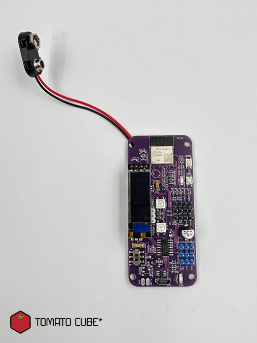

# TomatoCube ESP32-C3 PaddleWheel Controller Board

## (a) Description

The TomatoCube ESP32-C3 PaddleWheel Controller Board is built around Espressif's ESP32-C3-MINI-1 module with built-in PCB antenna for Wi-Fi and Bluetooth LE. A 9V battery step-down supply with MOSFET power switching suits battery-operated projects. Onboard peripherals include a speaker, level-shifted NeoPixels and servo outputs, and an I2C OLED display, with Grove and Qwiic connectors for external I2C devices. Spare GPIO pins are broken out for further expansion.

## (b) Instructions

Please refer to the **PaddleWheel Controller Board Quick Start Guide** for setup and first-use instructions.

👉 [PaddleWheel Controller Board Quick Start Guide](LINK-TO-QUICKSTART-GUIDE) [pending upload]

## (c) Firmware

PaddleWheel Controller Board firmware is loaded straight from your web browser - no software installation needed.

Open the loader:
👉 [TomatoCube ESP32-C3 Firmware Updater](https://tomatocube.com/file_dir/misc_files/ESP32-C3_Flasher/)

1. Which board do you have? - choose the "Generic ESP32-C3 with onboard LED".
2. What should it run? - choose your firmware:
   * MicroBlocks - if you are starting out with block coding
   * CircuitPython - if you are ready to write Python code
3. Flash it
   * Tick Erase everything first when switching between firmware types. Note: this deletes any programs and files saved on the board.
   * Hold Boot button and Toggle the Reset button to enter firmware uploader mode.
   * Select your board's serial port in the pop-up and click Connect.
4. Wait for the progress bar to reach 100%.
5. Press the Reset button (or unplug and replug) to start the new firmware.

